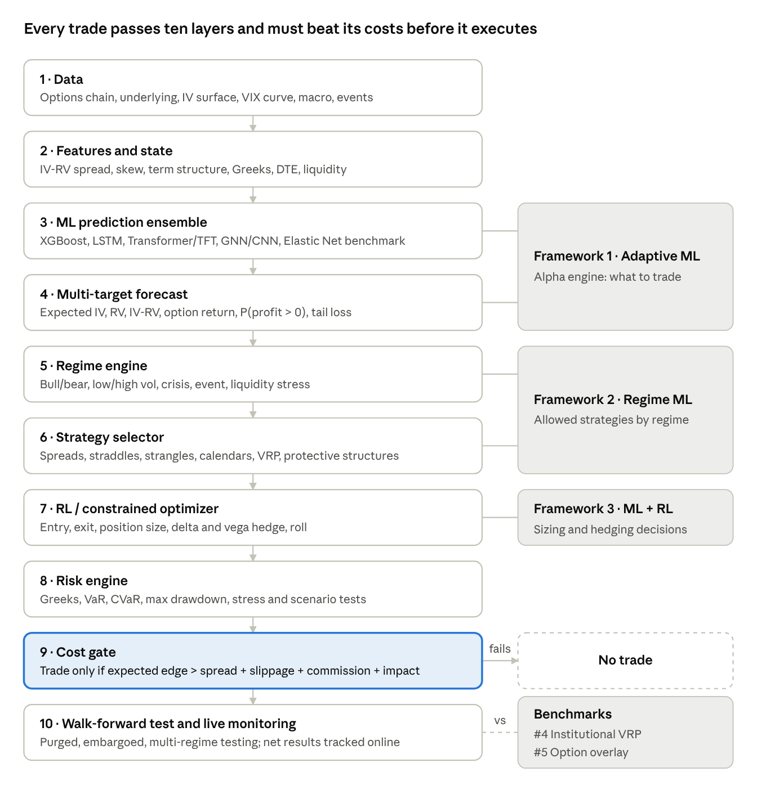

# Project Option Trading — ML Research Review & Handoff

Sep 27, 2026 · @Tony

## Overview

The conversation concludes that no single ML model wins in options
trading; a layered system that predicts volatility, selects a strategy
by regime, sizes and hedges positions, and trades only when the edge
beats costs is the recommended design.

Source: the shared ChatGPT project chat "Project Option trading"
([link](https://chatgpt.com/share/6ab9de6d-b8d8-83e8-ba15-3bcb3b369f4a)).
It contains four research exchanges plus a final request for a handoff
file. This document summarizes each exchange, pulls out the decisions,
and adds a critical review.

| \#  | Question asked                                                                                             | Main output                                                                                         |
|-----|------------------------------------------------------------------------------------------------------------|-----------------------------------------------------------------------------------------------------|
| 1   | Top 20 profitable ML models, with evidence, and the factors that make an ML trading model succeed          | Ranked list of 20 models, best models per task, 20 ranked success factors, a reference architecture |
| 2   | Summary table of all 20 models, with suitability for intraday, daily, medium-term and long-term trading    | Model × horizon matrix; six core model families selected                                            |
| 3   | Three best option-trading frameworks plus two institutional frameworks (#4, \#5), with goals and rationale | Five-framework comparison; objective hierarchy; six-layer final architecture                        |
| 4   | Add horizon suitability to the five-framework table                                                        | Framework × horizon table; daily + medium-term chosen as primary horizon                            |

The chat references an earlier study on the "top 20 option strategies"
that is not part of this shared link. The earlier handoff file ChatGPT
produced was also flagged by ChatGPT itself as incomplete.

## Discussion 1 — Top 20 ML models for options

XGBoost ranked \#1 overall, but the key finding was that the best model
is the one with a stable, after-cost, out-of-sample edge, not the lowest
prediction error. A cited 2026 study on 18.2 million minute-bar S&P 500
call observations found lower pricing error did not translate into
better trading P&L.

| Rank | Model                            | Best use in options                                 | Key evidence cited                                                                                              | Rating |
|------|----------------------------------|-----------------------------------------------------|-----------------------------------------------------------------------------------------------------------------|--------|
| 1    | XGBoost / gradient-boosted trees | IV, returns, probability of profit, trade selection | Boosting beat Black-Scholes / Corrado-Su in option pricing; XGBoost and RF most accurate across regimes         | 5      |
| 2    | LSTM / Bi-LSTM                   | IV/RV forecasting, sequential signals               | 2026 equity-option study (2018–2023): LSTM MSE ~4.35%, R² ~53%; pooled "universal" models beat per-stock models | 5      |
| 3    | Transformer / Autoformer         | Long-horizon, multi-source forecasting              | Autoformer beat simpler NNs on all US stocks, 920 features, data from 1957                                      | 5      |
| 4    | LightGBM                         | IV surface, very large tabular data                 | VAE → LightGBM → Monte Carlo beat Black-Scholes on NIFTY50 options                                              | 5      |
| 5    | Temporal Fusion Transformer      | Multi-horizon, heterogeneous features               | Built for multi-horizon forecasting with interpretable attention                                                | 5      |
| 6    | GRU                              | Hedging, IV/RV                                      | GRU-based hedging model beat benchmarks on S&P 500 options (J. Banking & Finance)                               | 4.5    |
| 7    | Random Forest                    | Robust baseline, classification                     | Strong in option pricing, but worst model in an FX-option IV study                                              | 4.5    |
| 8    | MLP                              | Cross-sectional pricing / returns                   | Gu–Kelly–Xiu: NN timing Sharpe 0.77 vs 0.51 buy-and-hold; long-short Sharpe 1.35; best at ~3 layers             | 4.5    |
| 9    | Graph Neural Network             | Whole option chain / surface                        | GNN with momentum spillover improved RMSE ≥8.81% on SSE 50 ETF options                                          | 4.5    |
| 10   | PPO (deep RL)                    | Dynamic hedging and trading                         | Among top performers in an 8-algorithm RL hedging comparison                                                    | 4.5    |
| 11   | DDPG / TD3                       | Continuous hedge sizing                             | Beat Black-Scholes delta hedge under costs for American options                                                 | 4      |
| 12   | CNN                              | IV surface as a 2D image                            | Predicted IV surface on SSE 50 ETF options, beat backprop NNs                                                   | 4      |
| 13   | VAE                              | Distribution / surface compression                  | Reproduces skew, kurtosis, fat tails in the NIFTY50 framework                                                   | 4      |
| 14   | Neural SDE                       | Pricing, scenario generation                        | Compared with Black-Scholes, Dupire and Heston on real options                                                  | 4      |
| 15   | Gaussian Process / Deep Kernel   | Small-data pricing with uncertainty                 | DKL beat Least-Squares Monte Carlo for high-dim American options                                                | 4      |
| 16   | N-BEATS / N-BEATS-GAN            | Time-series forecasting + risk                      | Limited option-specific evidence                                                                                | 3.5    |
| 17   | Elastic Net                      | Benchmark, feature selection                        | Positive out-of-sample R² where OLS failed (Gu–Kelly–Xiu)                                                       | 3.5    |
| 18   | SVR                              | Small/medium nonlinear data                         | Used as benchmark in pricing and volatility studies                                                             | 3.5    |
| 19   | CatBoost                         | Categorical / mixed features                        | ML beat Black-Scholes/Heston in several configurations                                                          | 3.5    |
| 20   | Ensemble / stacking              | Production robustness                               | DNN + GBT + RF combination was strongest in S&P 500 stat-arb study                                              | 5\*    |

**Seven possible prediction targets** were distinguished: direction,
return, realized volatility, implied volatility, option fair value,
probability of a profitable trade, and optimal action (the RL problem).
Choosing the target was called the most important decision in the
project.

**Best models by task** (top three of each list):

| Task                | 1st            | 2nd                | 3rd           |
|---------------------|----------------|--------------------|---------------|
| Realized volatility | LSTM           | XGBoost            | LightGBM      |
| Implied volatility  | LSTM / Bi-LSTM | XGBoost            | LightGBM      |
| Option pricing      | XGBoost        | LightGBM           | MLP           |
| Stock direction     | XGBoost        | MLP                | Random Forest |
| Dynamic hedging     | PPO            | Policy-gradient RL | DDPG / TD3    |

**Recurring lesson:** simple models often win with limited data; complex
models only pay off as data quality and quantity grow. Finance has low
signal-to-noise, nonstationarity and changing regimes.

## Discussion 1b — What makes an ML trading model succeed

Data quality, leakage prevention, target definition, transaction-cost
realism and out-of-sample validation were all rated 10/10 — judged more
important than the choice between XGBoost and LSTM.

| Rank | Factor                   | Score | Rank | Factor                      | Score |
|------|--------------------------|-------|------|-----------------------------|-------|
| 1    | Data quality             | 10    | 11   | Model calibration           | 9.5   |
| 2    | Leakage prevention       | 10    | 12   | Objective / loss function   | 9.5   |
| 3    | Target definition        | 10    | 13   | Ensemble diversity          | 9.4   |
| 4    | Transaction-cost realism | 10    | 14   | Interpretability            | 9.0   |
| 5    | Out-of-sample validation | 10    | 15   | Computational efficiency    | 8.5   |
| 6    | Regime robustness        | 9.9   | 16   | Hyperparameter optimization | 8.5   |
| 7    | Feature quality          | 9.8   | 17   | Retraining frequency        | 8.5   |
| 8    | Position sizing          | 9.8   | 18   | Uncertainty estimation      | 8.5   |
| 9    | Tail-risk management     | 9.8   | 19   | Execution infrastructure    | 8.5   |
| 10   | Nonstationarity handling | 9.7   | 20   | Model governance            | 8.0   |

**Key points behind the factors**

- **Leakage:** option data is especially prone to it — expiring
  contracts, IV derived from prices, asynchronous bid/ask, corporate
  actions, survivorship bias.

- **Targets:** predict future IV, IV change, mispricing, future RV,
  expected trade P&L or P(P&L \> 0) rather than raw next-day option
  price. The last two are most useful for trading.

- **Costs:** a model forecasting +0.20% per trade is worthless at 0.35%
  cost. A cited walk-forward study found XGBoost, LSTM and iTransformer
  signals failed after a 10 bp cost until a cost-aware threshold was
  added.

- **Metrics:** track prediction metrics (RMSE, MAE, R², log loss, Brier,
  calibration) separately from trading metrics (net Sharpe, Sortino,
  Calmar, max drawdown, expected shortfall, turnover, profit factor).

- **Features:** ten families — price, volatility, options (ATM IV, 25Δ
  skew, term structure, IV-RV spread), Greeks, flow, liquidity, VIX
  complex, macro, sentiment. Gu–Kelly–Xiu found momentum, liquidity and
  volatility interactions most predictive.

- **Universal models:** one pooled model across all underlyings (with
  per-underlying embeddings) beat separate per-stock models.

- **Surface modelling:** treat the whole IV(K, T) surface as one
  observation (CNN for local patterns, GNN for contract links, VAE for
  compression).

- **Calibration and distributions:** a calibrated 70% probability is
  worth more than a raw point forecast; prefer predicting the
  distribution of returns. A +0.6% forecast at 92% confidence was
  preferred over +1% at 51%.

- **LLMs:** not for numeric prediction; use them to extract signals from
  news, earnings calls, SEC filings and central-bank language
  (consistent with IMF and BIS views).

- **Institutional caution:** the Bank of England notes firms mainly use
  autonomous AI for research, coding and surveillance, not autonomous
  trading. The IMF warns of correlated behaviour and crowding.

**Validation protocol agreed**

1.  Statistical layer — does it predict IV, RV, returns?

2.  Economic layer — positive expectancy, Sharpe, Sortino, drawdown?

3.  Execution layer — still profitable after spread, commission,
    slippage, impact, latency?

4.  Crisis test — 2008, 2020, 2022 and gap events separately.

Walk-forward example: train 2010–2018, validate 2019–2020, test 2021;
then roll forward one year. Never random 80/20 splits.

**Explicit "do not" list:** LSTM on closing prices alone; trading
whenever predicted price \> market; accuracy as the main metric;
optimizing Sharpe on one period; 500 unregularized indicators; ignoring
bid/ask; one model forever.

**Learning-capability criteria** (ranked): nonlinearity, temporal
memory, cross-sectional learning, regime adaptation, transfer learning,
uncertainty estimation, online adaptation, robustness to missing data,
interpretability, retraining speed.

## Discussion 2 — Which model suits which trading horizon

Daily trading was named the largest opportunity: enough observations for
ML without the extreme microstructure costs of intraday. Horizons mean
the prediction/rebalancing horizon, not a promise of profit.

Star ratings from ChatGPT's final model × horizon matrix (5 = best).
Medium term = 1–12 weeks; long term = 3–12+ months.

| Model                    | Why it is good                               | Intraday | Daily | Medium | Long | Best role                           |
|--------------------------|----------------------------------------------|----------|-------|--------|------|-------------------------------------|
| XGBoost                  | Nonlinear interactions on tabular data, fast | 5        | 5     | 5      | 3    | IV/RV, trade selection, mispricing  |
| LSTM / Bi-LSTM           | Volatility persistence, sequences            | 4.5      | 5     | 5      | 3    | IV, RV, option-price forecasts      |
| LightGBM                 | Scales to huge option datasets               | 5        | 5     | 4.5    | 3    | IV surface, cross-sectional ranking |
| Transformer / Autoformer | Long-range, many features                    | 3        | 5     | 5      | 5    | Multivariate forecasting            |
| Random Forest            | Robust, low tuning                           | 4        | 4.5   | 4      | 3    | Classification, regime, filtering   |
| TFT                      | Several horizons at once                     | 3        | 5     | 5      | 5    | Multi-horizon IV/RV                 |
| GRU                      | Lighter LSTM                                 | 4.5      | 5     | 4.5    | 3    | Hedging, IV/RV                      |
| MLP                      | Simple, strong with engineered features      | 4        | 4.5   | 4.5    | 4    | Cross-sectional pricing             |
| GNN                      | Links across strikes and maturities          | 3        | 4.5   | 5      | 5    | Option chain / surface              |
| CNN                      | IV surface as an image                       | 4        | 4.5   | 4      | 3    | Smile, skew, term structure         |
| PPO                      | Learns decisions, not forecasts              | 4        | 4.5   | 4      | 3    | Sizing, hedging, execution          |
| DDPG / TD3               | Continuous actions                           | 4        | 4.5   | 4      | 3    | Dynamic hedging                     |
| Neural SDE               | Learns the price process                     | 2        | 3     | 4      | 5    | Pricing, simulation                 |
| VAE                      | Latent factors, distributions                | 3        | 4     | 5      | 5    | Surface compression                 |
| Gaussian Process / DKL   | Uncertainty estimates                        | 2        | 4     | 4.5    | 4.5  | Pricing + confidence                |
| N-BEATS                  | Dedicated time-series model                  | 3        | 4     | 4.5    | 4    | Volatility / returns                |
| Elastic Net              | Interpretable benchmark                      | 5        | 5     | 4      | 4    | Baseline, feature selection         |
| SVR                      | Small/medium nonlinear data                  | 3        | 4     | 4      | 3    | Pricing / IV                        |
| CatBoost                 | Categorical features                         | 5        | 5     | 4      | 3    | Cross-sectional prediction          |
| Ensemble / stacking      | Offsets individual weaknesses                | 5        | 5     | 5      | 5    | Final trade-ranking layer           |

**Horizon short-lists**

- **Intraday:** XGBoost, LightGBM, LSTM, GRU, RL — speed matters; a
  Transformer may predict better yet lose money on turnover.

- **Daily:** XGBoost, LSTM, LightGBM, Transformer, GNN.

- **Medium term:** LSTM, Transformer, TFT, GNN, XGBoost — time to
  exploit IV/RV divergence, regimes, term structure, earnings.

- **Long term:** Transformer, TFT, GNN, VAE, Neural SDE, simpler
  regularized models — few independent observations, so big deep models
  can underperform.

**Corrected reading of the ranking:** XGBoost wins general-purpose; LSTM
wins sequential volatility; Transformers win large multi-source data;
GNN wins option-chain structure; RL wins hedging decisions; Elastic Net
is the benchmark.

**Decision:** narrow the experiment to six core families — XGBoost,
LSTM, Transformer/TFT, GNN, PPO/deep hedging, Elastic Net — and keep the
other 14 as secondary benchmarks. Separate the prediction layer from the
decision layer.

## Discussion 3 — Five frameworks, their goals and rationale

The Adaptive ML Volatility + Relative-Value framework ranked \#1, but
the final recommendation was to combine frameworks 1–3 and use 4 and 5
as institutional benchmarks. Frameworks 4 and 5 are public institutional
archetypes, not proprietary bank systems.

| \#  | Framework                                              | Core philosophy                                                               | Main goal                             | Profit | Risk control | Why it was chosen                                                                                                      |
|-----|--------------------------------------------------------|-------------------------------------------------------------------------------|---------------------------------------|--------|--------------|------------------------------------------------------------------------------------------------------------------------|
| 1   | Adaptive ML Volatility + Relative-Value + Risk Control | ML predicts IV/RV/returns → finds mispricing → picks strategy → sizes by risk | Maximize net risk-adjusted alpha      | 5      | 4.5          | Strongest academic support: RFS study, 12M+ observations 1996–2020, ML option-return portfolios profitable after costs |
| 2   | ML Multi-Strategy Regime-Switching                     | Detect regime → activate the strategy that fits it                            | Consistency across regimes            | 4.5    | 5            | Option payoffs depend on regime; AQR found buying options only paid in the top decile of volatility changes            |
| 3   | ML + Deep Hedging / RL                                 | ML finds opportunity; RL decides entry, size, hedge, exit                     | Maximize net P&L after costs and risk | 5      | 5            | Static IV fit and real hedging results diverge once costs and risk aversion are included                               |
| 4   | Institutional VRP / Risk-Target                        | Systematically sell volatility with vol targeting and tail controls           | Stable VRP harvesting                 | 4      | 4.5          | Mirrors public AQR, Parametric / Morgan Stanley and Man Group approaches                                               |
| 5   | Institutional Option-Overlay / Outcome                 | Options change a portfolio's risk/return (puts, covered calls, collars)       | Optimize portfolio outcome            | 3      | 5            | Mirrors BlackRock and Morgan Stanley overlay and income strategies                                                     |

**Framework details**

- **\#1 targets:** IV change, realized vol, IV-RV spread, expected
  option return, P(profit \> 0), CVaR. Models: XGBoost (tabular), LSTM
  (sequences), Transformer (long-range), GNN/CNN (surface), Elastic Net
  (benchmark), meta-model (combine). Objective: maximize Sharpe +
  Sortino minus penalties for CVaR, max drawdown and turnover, within
  Greek and position limits.

- **\#2 regimes:** low IV / low RV, high IV / falling RV, high IV /
  rising RV, bull, bear, crisis, earnings, liquidity stress. Example
  rules: high IV + stable RV → short-vol spreads; high IV + rising RV →
  cut short vol; extreme VIX → defined risk only; illiquid → no trade.
  Supported by the IMF 2026 GFSR on dealer gamma and 0DTE growth.

- **\#3 reward:** P&L minus costs, CVaR, drawdown and turnover penalties
  — not raw P&L. RL is the decision engine, not the alpha engine.

- **\#4 caution:** AQR warns sharp moves create meaningful VRP
  drawdowns, so sizing must reflect tail risk.

- **\#5 goal:** reduce drawdown and volatility, generate income, protect
  concentrated positions — not maximum profit.

**Scorecard highlights (5 = best):** frameworks 2 and 3 score 5 on
drawdown and CVaR control; \#1 scores 5 on profit and Sharpe; \#4 and
\#5 score highest on interpretability and institutional resemblance; \#3
has the lowest interpretability and highest cost sensitivity.

**Transaction-cost warning:** a 2026 LSTM study saw raw profits eroded
by bid/ask, with delta-hedged results turning negative at large spreads.
The agreed rule: trade only if expected edge \> bid/ask + slippage +
commission + market impact; otherwise no trade.

## Discussion 4 — Framework × horizon and the objective hierarchy

Daily plus medium-term was chosen as the primary research horizon, with
intraday as a separate later module. ML-heavy frameworks fit daily and
medium term best; institutional frameworks gain ground at long horizons.

| Framework                | Main goal                  | Intraday | Daily | Medium | Long |
|--------------------------|----------------------------|----------|-------|--------|------|
| 1 Adaptive ML            | Net risk-adjusted alpha    | 4.5      | 5     | 5      | 4    |
| 2 Regime-Switching ML    | Consistency across regimes | 4.5      | 5     | 5      | 5    |
| 3 ML + Deep Hedging / RL | Dynamic P&L after costs    | 4        | 5     | 5      | 4.5  |
| 4 Institutional VRP      | Stable VRP harvesting      | 3        | 4.5   | 5      | 5    |
| 5 Institutional Overlay  | Portfolio outcome          | 2        | 4     | 4.5    | 5    |

- **Intraday:** edge must beat bid/ask, slippage, commissions, impact
  and latency; favour fast models and a strict trade filter.

- **Daily:** best compromise. A July 2026 Federal Reserve paper using
  boosted trees on moneyness/maturity partitions cut one-month-ahead IV
  RMSE by 13% versus its benchmark.

- **Medium term (1 week–3 months):** Regime ML ranks first; more time to
  overcome costs.

- **Long term (3 months+):** Regime ML, Institutional VRP and Overlay
  lead; structural risk premia matter more than short-term signals.

**Objective hierarchy agreed for the project**

| Priority | Objective            | What is measured                               |
|----------|----------------------|------------------------------------------------|
| 1        | Survival             | CVaR, stress loss, probability of ruin         |
| 2        | Risk control         | Max drawdown, Greeks, concentration, liquidity |
| 3        | Risk-adjusted profit | Sharpe, Sortino                                |
| 4        | Net profit           | CAGR / total P&L after all costs               |
| 5        | Efficiency           | Return per unit of turnover, margin, capital   |
| 6        | Prediction quality   | RMSE, MAE, AUC — supporting metrics only       |

Ultimate objective: maximum sustainable net risk-adjusted return,
subject to predefined limits on CVaR, max drawdown, Greeks, turnover,
liquidity and margin.

## Recommended final architecture

The end state is a hybrid of frameworks 1, 2 and 3, validated against 4
and 5, where prediction, strategy choice, sizing, risk and execution are
separate layers rather than one model deciding everything.

recommended ML options system · 10 layers, 3 frameworks, 2 benchmarks

Signals flow top to bottom; any trade whose expected edge does not clear
total costs stops at the cost gate.

**Decisions carried forward**

- Core model families: XGBoost, LSTM, Transformer/TFT, GNN (or CNN),
  PPO/deep hedging, with Elastic Net as the control.

- Prediction layer and decision layer stay separate.

- Optimize net P&L after realistic costs, not RMSE.

- Primary horizon: daily + medium term; intraday as a separate later
  module.

- Institutional VRP and option-overlay frameworks act as benchmarks the
  ML system must beat.

- Planned next study: top 20 option strategies × top 20 ML models ×
  features × DTE × delta × IV/RV × VIX regime × costs, tested
  walk-forward on Sharpe, Sortino, max drawdown, CVaR and probability of
  profit.

## Critical review

The conversation's core logic is sound and matches mainstream quant
practice, but its rankings are subjective, several numbers conflict
internally, and many cited 2026 studies should be verified before they
drive decisions.

**Strengths**

- Puts after-cost, out-of-sample economics ahead of prediction accuracy
  — the right priority.

- Strong emphasis on leakage, walk-forward testing, crisis tests and
  calibration.

- Separating prediction, strategy selection, sizing, risk and execution
  is a defensible design.

- Keeps simple benchmarks (Elastic Net, institutional VRP) that complex
  models must beat.

- Cites peer-reviewed and institutional sources (RFS, Gu–Kelly–Xiu, AQR,
  BIS, IMF, Bank of England).

**Internal inconsistencies to resolve**

| Issue                                                                                                   | Where it appears        | Why it matters                                                   |
|---------------------------------------------------------------------------------------------------------|-------------------------|------------------------------------------------------------------|
| Bi-LSTM called "best", yet its quoted MSE (4.65%) is worse than plain LSTM (4.35%) and ConvLSTM (4.44%) | Discussion 1, model \#2 | Either the figures or the claim is wrong; check the source paper |
| Model order shifts: Transformer \#3 and RF \#7 overall, but LightGBM \#3 and RF \#5 in the tiered list  | Discussion 1            | The ranking is opinion, not a stable result                      |
| Transformer marked green (suitable) for intraday in one table but 3/5 in the matrix                     | Discussion 2            | Use the matrix; state the latency caveat                         |
| PPO is in the "top five to build", yet also "not the first model"                                       | Discussions 1 and 3     | Sequence it: build prediction and risk layers first, RL later    |
| Nearly every model and framework scores 4–5 stars                                                       | All tables              | Ratings do not discriminate; treat them as hypotheses to test    |
| Success-factor scores (9.9 vs 9.8) imply false precision                                                | Discussion 1b           | Use tiers (critical / important / useful) instead                |

**Claims that need verification**

- Many cited items are 2026 papers, SSRN preprints or arXiv drafts;
  confirm each exists and says what is claimed before relying on it.

- Specific numbers to re-check: 18.2M minute-bar observations; LSTM R²
  ~53%; GNN ≥8.81% RMSE gain; 13% Federal Reserve IV RMSE reduction; RFS
  12M+ observations study.

- Gu–Kelly–Xiu figures (Sharpe 0.77 vs 0.51; 1.35 long-short) come from
  US equities, not options; transfer to options is an assumption.

- The Sharpe/RMSE worked examples (e.g. Elastic Net 0.72 vs XGBoost
  0.81) are illustrations, not results.

**Gaps not covered**

- Data sourcing and cost: which vendor (e.g. OptionMetrics, ORATS, CBOE
  DataShop), history length, and budget.

- Compute and infrastructure plan, especially for Transformers, GNNs and
  RL.

- Statistical safeguards against multiple testing (e.g. deflated Sharpe,
  White's reality check) — critical for a 20 × 20 grid.

- Margin, capital requirements and early assignment for American-style
  options.

- Concrete regime definitions (thresholds for VIX, IV/RV, term
  structure).

- The earlier "top 20 option strategies" study is referenced but not
  included here.

- Nothing guarantees future profitability; ChatGPT itself notes no cited
  study proves a live strategy will stay profitable.

## Next steps

Build the simplest version end to end first, then add complexity only
where it beats the benchmark after costs.

1.  Verify the key papers and numbers flagged in the review.

2.  Bring in the "top 20 option strategies" study so the strategy ×
    model grid can be defined.

3.  Choose a data vendor and lock the dataset: underlyings, date range,
    frequency, bid/ask quality.

4.  Define targets (IV change, RV, IV-RV, P(P&L \> 0), expected P&L) and
    write down regime thresholds.

5.  Build baselines: Elastic Net, institutional VRP rule, simple
    overlay.

6.  Add XGBoost/LightGBM, then LSTM; test walk-forward with realistic
    costs and the cost gate.

7.  Add regime engine and strategy selector; then Transformer/GNN; then
    RL for sizing and hedging.

8.  Apply multiple-testing corrections before calling any result an
    edge; paper-trade before any capital.

## Sources

Source conversation: [Project Option trading — shared ChatGPT
chat](https://chatgpt.com/share/6ab9de6d-b8d8-83e8-ba15-3bcb3b369f4a).
The references below are those ChatGPT cited; they were not
independently opened for this review.

- **Option-specific ML:** Predicting option prices from their price
  history (Review of Derivatives Research, 2026); Option Return
  Predictability with Machine Learning and Big Data (Review of Financial
  Studies); Option pricing using Machine Learning (Expert Systems with
  Applications); Non-parametric option pricing before and during
  COVID-19; Forecasting implied volatilities of currency options with
  ML; GNN momentum spillover in option pricing (Journal of Futures
  Markets); CNN implied-volatility surface prediction; VAE option
  pricing on NIFTY50; Neural-SDE pricing and hedging; Gaussian-process
  and deep-kernel American option pricing; Learning sequential option
  hedging models (Journal of Banking & Finance); Deep RL algorithms for
  option hedging; Hedging American puts with deep RL; When Lower Pricing
  Error Trades Worse (SSRN, 2026).

- **General financial ML:** Gu, Kelly & Xiu, Empirical Asset Pricing via
  Machine Learning (RFS / NBER / AQR); DNN, gradient-boosted trees and
  random forests for S&P 500 statistical arbitrage; Transformers vs
  simple NNs for stock returns; ML stock-market volatility forecasting;
  Office of Financial Research 2026 forecasting benchmark; Federal
  Reserve July 2026 tree-based IV forecasting.

- **Institutions:** Bank of England Financial Stability Report (July
  2026); BIS papers on ML for market monitoring and the
  expected-shortfall framework; IMF Global Financial Stability Report
  2026 and AI-in-markets papers; AQR on the volatility risk premium and
  buying options; BlackRock on options and overlays; Morgan Stanley /
  Parametric VRP and Global Balanced Income; Man Group risk premia; MSCI
  on nonlinear factor effects; CFA Institute on deep learning and trade
  execution.
